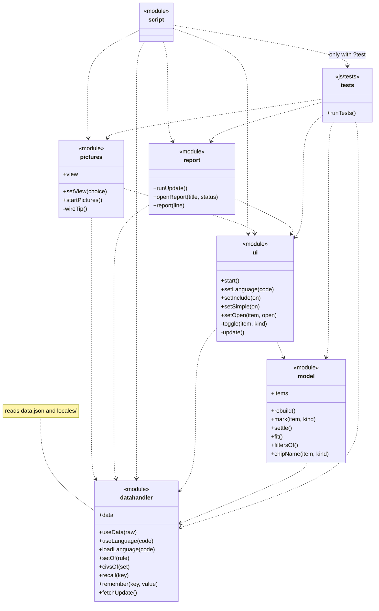

# Looking after AoE2 Civ Explorer

This guide is for whoever keeps the page up to date. You do not need to be a programmer for the usual job, which is
updating the page after Age of Empires II gets a patch. That takes a browser, a text editor and about ten minutes.

The guide starts with how the page is put together, because the update steps make more sense once you know that.
If you are in a hurry, jump to [After a game update](#after-a-game-update).

## How the page is put together

The page is a handful of files, a folder of scripts and a folder of language files. There is nothing to install and
nothing to build: the files you see are exactly the files a visitor's browser downloads.

| File | What it holds |
| --- | --- |
| `index.html` | The structure of the page: the header, the two panes, the options window with the language menu. It holds no text of its own. |
| `style.css` | How the page looks: colours, sizes, the layout for big and small screens. |
| `script.js` | Where the page starts. The rest of its behaviour is in `js/`, as listed below. |
| `js/` | How the page behaves, split into the scripts listed below. |
| `data.json` | Everything the page knows: the civilisations, the tree, which civilisation has what, and every piece of text in English, the default language. |
| `favicon.ico` | The small icon browsers show in the tab and in bookmarks. |
| `assets/images/` | The pictures, which Simple UI turns off: the backgrounds of the page and the Options window in `ui/backgrounds/`, the buttons and the Find box in `ui/buttons/`, the checkboxes in `ui/checkboxes/`, the mouse cursors in `ui/cursors/`, the panes' frames in `ui/panels/` and the civilisations' icons in `icons/civs/`. See [The background pictures](#the-background-pictures). |
| `assets/fonts/` | The fonts used only with the pictures on: Georgia, Times New Roman Bold and Trajan Pro Bold. See [The panels](#the-panels) and [Civ view](#civ-view-list-or-tiles). |
| `locales/` | One file per other language, such as `locales/de.json` for German, with every piece of text in that language. |
| `documentation/` | This guide and the project's other documents: `RULES.md`, `REQUIREMENTS.md`, `TESTS.md`, `DEVLOG.md` and `code_docu.pdf`. |

Two more files help you: `README.md`, which introduces the project, and `.github/workflows/tests.yml`, which tells
GitHub to run the tests every time someone pushes a change.

The scripts each have one job. They use the browser's own way of loading scripts from each other, called
modules, so they need no build step and no extra tools:

| Script | Its job |
| --- | --- |
| `script.js` | Where the page starts. It loads the data, starts the page, and loads the tests or the updater when asked. |
| `js/datahandler.js` | Everything about data: loading `data.json` and the language files, the chosen language and its text, which civilisations have what, saved choices such as the language, and the updater that fetches new data and writes the files. |
| `js/model.js` | The tree and its rules: which items are shown, which are marked, and when marking one item marks others. |
| `js/ui.js` | Everything on the screen: drawing the tree and the list, clicks and keys, the language menu, the options window and Simple UI. |
| `js/pictures.js` | What only the pictures need: Civ view (list or tiles) and the tooltip. It was split off when `js/ui.js` neared 400 lines of code. |
| `js/report.js` | The report window of the updater and the tests, split off from `js/ui.js` for the same reason. With `js/ui.js` and `js/pictures.js`, it is one of the three scripts that touch the screen. |
| `js/tests/` | The tests. They are only loaded when the address ends in `?test`, so visitors never download them. |

No script may grow past 400 lines of code; blank lines do not count. When one does, the tests fail, and it is time to move part of it into a new script
in `js/`, or into a new test file in `js/tests/`. Give it a name in lower-case letters only, such as `menu.js`. Import the new script where it is needed, as the others do; the
tests find every script by following those imports.

The most important idea is that **all the facts live in `data.json` and the language files**. The other files never
mention a unit, a civilisation or a sentence. So a game update only ever changes `data.json` and the language files,
and you rarely need to open the other files at all.

A visitor's browser downloads `data.json` and the file of the language it shows, not all 17.

### Where the facts come from

The facts come from [aoe2techtree.net](https://aoe2techtree.net/), the community tech tree site. That site reads the
game's own files after every patch and publishes, for each civilisation, which buildings, units and technologies it
has, and the game's names for them in every language the game supports. This page offers the same 17 languages.

The page never contacts aoe2techtree.net while a visitor uses it. Instead, you copy the facts into `data.json` once
per patch, with the updater described below. That keeps the page fast and keeps it working even if that site is
down.

### What is in `data.json` and the language files

`data.json` is a text file in a format called JSON. You can open it in any text editor. Its main parts are:

- `source`: where the data comes from, and `updated`, the month it was last fetched. The footer of the page shows it,
  followed by `notice`, the notice Microsoft's [Game Content Usage Rules](https://www.xbox.com/en-US/developers/rules)
  ask for. In it, `{rules}` becomes a link to those rules, whose name and address are in `rules`. The notice is a legal
  text, so it stays in English in every language, and the page marks it as English for screen readers. The footer
  spans the page, with Simple UI or without, so the notice takes few lines. With the pictures on, each civilisation
  links to its page on aoe2techtree.net: `url`, then `#` and the civilisation's English name.
- `languages`: the 17 languages. The first, English, is the default: its text is in `data.json` itself, and every
  other language has its own file in `locales`, named after its code. Each language has a `name` (as it is written
  in that language), a `tag` (the standard code that tells browsers and screen readers which language the text is
  in), and two settings the updater uses when it tidies the game's names: `spaces` (does the language put spaces
  between words?) and `mergeHyphens` (does a hyphen at the end of a line in the game's text split a single word, as
  in German?).
- `civs`: the civilisations, by their English names.
- `icons`: where the civilisations' icons are, and the file names that differ from the civilisations' names. See
  [The civilisation icons](#the-civilisation-icons).
- `tree`: what the left pane shows, in order. **You edit this by hand.**
- `availability`: for each item in the tree, which civilisations have it. The updater writes this; never edit it.
- `ignore`: names from the game that you have decided not to show. **You edit this by hand.**
- `overrides`: corrections to English names from the game. **You edit this by hand.**
- `tools`: the English text of the updater and the tests.
- `text`: the English text, in four parts: `ui` (the page's own sentences), `groups` (the headings in the tree, such
  as Economy), and `civs` and `items` (the names of civilisations and items, which the updater writes).

Each file in `locales` holds the same two parts, `overrides` and `text`, for one other language. For example,
`locales/de.json` holds the corrections to German names and all the German text. Everything else is shared by all
languages, so it is only in `data.json`.

### The background pictures

Behind the panes the page shows a picture of a parchment pinned to a wooden board. There are four versions of it, in
`assets/images/ui/backgrounds/`, and a visitor's browser downloads only the one that suits their window:

| Picture | Size | Used when the window is |
| --- | --- | --- |
| `fhd.webp` | 1920 by 1080 | at most 1920 by 1080 pixels |
| `qhd.webp` | 2560 by 1440 | bigger than 1920 by 1080, up to 2560 by 1440 |
| `uhd.webp` | 3840 by 2160 | bigger than 2560 by 1440 |
| `ultrawide.webp` | 5120 by 2160 | wider than 16:9, whatever its size |

"Window" means the part of the browser that shows the page, without its tabs and address bar. That part of a
maximised browser on a 16:9 screen is usually wider than 16:9, so it gets `ultrawide.webp`.

The choice is made in `style.css`, in the rules that start with `.pictures body`. The picture always fills the
window and stays centred; whatever does not fit is cut off at the edges.

The header, the panes and the footer sit on the parchment, between the two pins at its top corners. The panes have
frames of their own; the footer's words sit straight on the parchment, in `#391c1b`, across the full width of the panes. Five numbers in the `.pictures body` rule say where that area is, each as a share of the
picture:

| Number | Means | `fhd`, `qhd`, `uhd` | `ultrawide` |
| --- | --- | --- | --- |
| `--ratio` | the picture's width divided by its height | `16 / 9` | `64 / 27` |
| `--left` | how far from the picture's left edge the page starts | `0.155` | `0.2325` |
| `--right` | how far from the picture's left edge the page ends | `0.87` | `0.7636` |
| `--top` | how far from the picture's top edge the page starts | `0.03` | `0.031` |
| `--bottom` | how far from the picture's top edge the page ends | `0.967` | `0.968` |

For example, `fhd.webp` is 1920 pixels wide and the page starts at 0.155 of that, about 298 pixels from its left edge.
From these numbers `style.css` works out, for any window, where the parchment lands and pads the page to fit it.
When a window is so narrow or so tall that the parchment fills it, the page keeps its usual 16-pixel margin.

### The title

With the pictures on, the header has no panel of its own. The title reads **Civ Explorer**, in bold Georgia coloured
`#391c1b`, centred in a decorated frame at the top centre of the parchment, with the Options button to its right.
The frame is `title_frame_sd.webp` (784 by 116) or `title_frame_4k.webp` (twice the detail), from
`assets/images/ui/backgrounds/`, chosen on the same terms as the Options button. It is at most 784 pixels wide and
shrinks with narrow windows, and the title shrinks with it, down to 12 pixels. The frame's own edges fade out, and
`style.css` fades them a little more with a `mask-image`, so that it blends into the parchment.

The title sits in the frame's plain inner box, which spans 20.28% to 79.59% of its width and 36.21% to 70.69% of its
height. The `padding` on `.pictures h1` is that box, written as shares of the frame's width, because CSS reads
padding percentages that way. If the frame is replaced by one with a different inner box, measure it and change the
padding.

With Simple UI on, the title stays the full sentence of requirement 2. Both texts are in the language files:
`title` is the full sentence, and `titleShort` is "Civ Explorer", the same in every language. `index.html` holds both
in the heading, and `style.css` shows the one that fits the mode.

### The Options button

With the pictures on, the cogwheel button at the top right is a picture too, from `assets/images/ui/buttons/`. Each
file is a strip of three square pictures of the button side by side: on the left as it normally looks, in the middle
when the mouse is over it, and on the right while it is pressed. `style.css` shows one third of the strip at a time,
by moving it to the left (0%), the middle (50%) or the right (100%).

| Picture | Size | Used when |
| --- | --- | --- |
| `options_sd.webp` | 156 by 52, three 52 by 52 pictures | the window is at most 1920 by 1080, on an ordinary screen |
| `options_4k.webp` | 312 by 104, three 104 by 104 pictures | the window is bigger than 1920 by 1080, or the screen is sharper than usual |

The button is 52 by 52 on the page either way; `options_4k.webp` has twice the detail, for sharp screens. A "sharper
than usual" screen packs more than one of its own pixels into each of the page's pixels, as on most phones and on
laptops set to 125% or more. Its real resolution is then larger than 1920 by 1080 even when the window is smaller.

Around the button is a 2-pixel ring in the colour `#ee9d05`, the `box-shadow` in the same rule in `style.css`. It
is not an `outline`, because the page uses `outline` to show which control has keyboard focus.

### The text buttons

With the pictures on, every button with words on it looks like a button from the game: Clear, Expand all, Collapse
all, the language menu and its choices, and Close. Its picture is `button_sd.webp` or `button_4k.webp` from
`assets/images/ui/buttons/`, a strip of three bars on top of each other: normal at the top, under the mouse in the
middle, and pressed at the bottom. `button_4k.webp` is used when the window is bigger than 2560 by 1440, as for
`uhd.webp`, and `button_sd.webp` otherwise.

Each bar has gold ends, which must not be stretched. So the button is drawn in three parts. The bar fills the
button, which stretches only its plain red middle. On top, `::before` and `::after` draw its left and right ends at
their own shape, 12 by 50 of the picture's pixels, scaled to the button's height. All three follow the mouse
together, from the top (0%) to the middle (50%) and the bottom (100%) of the strip. Because `::after` draws the right
end, the language menu's arrow is a `<span class="chevron">` of its own.

The words are bold Georgia in `#f2d2b6`, with a black shadow at 50% opacity, 2 pixels down and 2 to the right. Each
button holds its words in a `<span class="caption">`. The language menu's button keeps its words on one line, so that
the Simple UI box below it stays in place when Simple UI is turned on or off; in a very narrow window a long language
name ends in "…".

### The checkboxes

With the pictures on, every checkbox is a picture from `assets/images/ui/checkboxes/`: in the tree, in the legend, on
the filter buttons and in the Options window. Each file is a sheet of three rows and three columns:

| | Normal | Under the mouse | Pressed |
| --- | --- | --- | --- |
| **Empty** | not marked | | |
| **Ticked** | must have | | |
| **Crossed** | must lack | | |

`style.css` sizes the sheet to three times the box each way and picks the row by the box's state (0%, 50% or 100%
down) and the column by the mouse (0%, 50% or 100% across). The column changes when the mouse is over the whole row
of the item, the Options choice or the filter button, as that is what a click acts on. A branch that is partly
marked has no picture of its own, so it shows the empty box with a black dash drawn over it.

| Picture | Size | Used when |
| --- | --- | --- |
| `checkboxes_sd.webp` | 60 by 60, nine 20 by 20 pictures | the window is at most 1920 by 1080, on an ordinary screen |
| `checkboxes_4k.webp` | 120 by 120, nine 40 by 40 pictures | the window is bigger than 1920 by 1080, or the screen is sharper than usual |

The boxes are 20 by 20 on the page either way, as for the Options button.

### The panels

With the pictures on, each pane sits in a frame drawn from one picture in `assets/images/ui/panels/`, cut into nine
pieces: four corners, four edges and the middle. `style.css` does this with `border-image`. None of the pieces is
stretched: the corners keep their shape, and the edges and the middle are repeated (`repeat`) to fill the pane. The
first number after the picture is where to cut, in the picture's pixels, and the length after the slash is how wide
the corners and edges are on the page.

| Pane | Picture | Cut | Frame on the page | Text |
| --- | --- | --- | --- | --- |
| Buildings, units and technologies | `nodes9slice.webp`, 192 by 192 | 64, a third | 30 pixels | Georgia, `#391c1b` |
| Civilisations | `civs9slice.webp`, 256 by 256 | 85, about a third | 30 pixels | Times New Roman Bold, white |

Cut at a third, each corner holds the whole of its ornament. A cut that runs through the gold corners would repeat
slivers of them along the edges. The civilisations' frame's middle is 80% black, so a little of the parchment shows
through.

The panes' own grey headers are see-through with the pictures on, so the frames show. A few colours were changed to
suit them. In the tree, the highlight under the mouse is a light tint and Find's highlight a gold tint. Among the
civilisations, the filter buttons and the dividing lines are orange. Each civilisation has its icon before its name;
see [The civilisation icons](#the-civilisation-icons).

In the tree pane, the legend is left out with the pictures on, as the tooltip says the same. The Find box comes first
and the three buttons below it, and its "Find" label is hidden from sight but still read out by screen readers.

The fonts come from `assets/fonts/`: `Georgia.ttf` and `timesbd.ttf` (Times New Roman Bold). `style.css` names them
"Civ Georgia" and "Civ Times" and tries the copy installed on the visitor's computer first, so most visitors download
neither file. They have their own names because a font loaded as plain "Georgia" would hide the installed Georgia's
bold. The title and the buttons use "Civ Georgia" too.

### The Find box

With the pictures on, the Find box is drawn from `textfield_9slice.webp` in `assets/images/ui/buttons/`, 45 by 45,
cut into nine pieces of 15 by 15 that are repeated, never stretched. While the box is empty, `search.webp` shows at
its right end. While it holds text, `clear_search.webp` shows there instead, as a button that empties the box and puts
the cursor back in it. `style.css` tells the two apart with `:placeholder-shown`, which is why the box has a
placeholder of one space. The box has no focus ring with the pictures on; the text cursor shows where you type.
With Simple UI it keeps the ring, as WCAG asks. The box is always 325 pixels wide, so it does not change size while you type. It narrows only in a pane too narrow
for 325 pixels and 6em beside it, and then still not while you type.

The search's messages, such as "2 found" and "None found", always show to the right of the box, never below it, with
the pictures on or off, and on one line only. The row with the box never wraps, and the message never wraps either: if
it does not fit, it ends in "…", though screen readers still read all of it. With the pictures on, the message has
whatever the box leaves, at least 6em, is aligned right, and reaches 6 pixels into the pane's padding, so that it ends
close to the pane's edge. With Simple UI its column is up to 12em wide and at least 6em, and stays the same width
while typing.

### The tooltip

With the pictures on, a small parchment note, "Left-click to enable, right-click to disable", follows the mouse over
the items of the tree. Over a civilisation, it shows the address its link leads to instead. Its top-left corner sits at the bottom-right corner of the cursor's picture: 32 pixels right of
and below the pointer with the `x1` cursors, 48 with the `x2` ones. Near the window's right edge it moves left, and
near its bottom it moves above the pointer. It looks like the tooltips of
[frcp.net](https://github.com/cnordenb/frcp.net). Its text over the tree is `nodeTip` in the language files. It shows only for a
mouse, not for touch or the keyboard, where the legend of Simple UI explains the same.

`js/pictures.js` places it by setting the custom properties `--x` and `--y` to the pointer's position, as numbers.
`style.css` turns them into `left` and `top`. The cursor's size is `--reach` on `.tip` in `style.css`, set next to the
cursor pictures so the two always match; `js/pictures.js` reads it from there. This is the only way the scripts give CSS anything: plain numbers through
custom properties, never a style of their own. The tests check this.

### The civilisation icons

With the pictures on, the list of civilisations shows each one's icon before its name, from
`assets/images/icons/civs/`. The file is named after the civilisation's English name in lower case, such as
`celts.png`. Where the game's file has another name, `icons` in `data.json` says so: Incas use `inca.png` and Mayans
`maya.png`. `icons` also holds the folder.

When a game update adds a civilisation, add its icon to that folder, named in lower case after its English name, or
add its file's name to `icons`. The tests mark an item many civilisations have and check that every icon in the list
loads.

### Links to the civilisations' pages

With the pictures on, each civilisation in the list, and each tile, is a link to its page on aoe2techtree.net, such as
[https://aoe2techtree.net/#Armenians](https://aoe2techtree.net/#Armenians) for the Armenians. `js/ui.js` builds the
address from `url` in `source` in `data.json` and the civilisation's English name, so the links follow the source if
it ever moves. With Simple UI the civilisations are plain text and link nowhere. The tests check that each link
leads to the right page, that the tooltip shows it, and that Simple UI takes the links away.

### Civ view: list or tiles

With the pictures on, the Options window has a choice, **Civ view:**, between **List** and **Tile**. The choice is
remembered. List is the usual list of names, each with its icon. Tile shows each civilisation as a box from
`assets/images/ui/panels/civ_box_sd.webp` (123 by 123) or `civ_box_4k.webp` (twice the detail, on the same terms as the
Options button), with its icon in the black part and its name on the red bar.

The boxes are square and come six to a row, whatever the pane's width; the 6 is in `.pictures .civs.tiles` in
`style.css`. Everything in a box is sized as a share of the box's width (`cqi`), as measured on the 123-pixel
picture: the black part spans rows 2 to 97, so the icon is 88/123 of the box and sits 6/123 from the top; the red bar
spans rows 100 to 120, so the name sits there, centred, in Trajan Pro Bold from `assets/fonts/TrajanPro-Bold.ttf`, at
12/123 of the box. The name fades from white at the top to `#ff9900` at the bottom and has a black shadow at 50%
opacity, 2 pixels down and 2 to the right. A name too long for the bar ends in "…".

The choice is radio buttons drawn from `assets/images/ui/checkboxes/radiobutton_sd.webp` (48 by 48) or
`radiobutton_4k.webp`, a sheet of four 24 by 24 pictures: on the top row not chosen, normal and under the mouse; on the
bottom row chosen, normal and pressed. With Simple UI the choice is hidden and the list is always shown, as the tiles
are made of pictures. The choice sits below the Simple UI box, so hiding it does not move that box. Its texts are
`civView`, `viewList` and `viewTile` in the language files.

### The Options window

With the pictures on, the Options window is a panel framed with `nodes9slice.webp`, as the tree pane is, lying on a
sheet of parchment: `assets/images/ui/backgrounds/options_sd.webp` (652 by 688) or `options_4k.webp` (twice the
detail, on the same terms as the Options button). The title "Options" sits in the parchment's title frame, in bold
Georgia.

The window itself keeps exactly the size, padding and text it has with Simple UI, so that ticking Simple UI does not
move its box (Rule 18; the tests check it). Everything else is drawn around it:

- The frame is drawn by `.options::before`, which covers the rows below the title and reaches 17 pixels past them,
  out to the window's edges. The title keeps its row, so nothing below it moves, and `translate` lifts it into the
  parchment's title frame. The text keeps the page's usual font: in Georgia, the hint would wrap differently and
  move the Simple UI box.
- The parchment is drawn on the window's `::backdrop`, over the usual shade. It is scaled so that the panel fits in
  the box from 60 to 592 across and 95 to 622 down, in the picture's pixels: inside the thin inner border and below
  the title frame. The panel is centred in that box.

The numbers in `style.css` come from these measurements, in the picture's pixels:

| Number | Means |
| --- | --- |
| 1.22556 (652 / 532) and 1.23719 (652 / 527) | The picture's width for each pixel of the panel's width or height; the larger of the two is used. |
| 0.02224 (14.5 / 652) | How far the middle of the box (358.5 down) is below the middle of the picture (344 down). |
| 0.0092 (6 / 652) and 0.46166 (301 / 652) | How far the middle of the title frame (332 across, 57.5 down) is right of and above the middle of the box. |
| 0.3 | The title's width, a little less than the title frame's (218 of 652). |

`--lid` is the height of the title's row and the gap below it, which the panel leaves out. The tests work out where
the title should be from the same measurements.

In windows less than 588 pixels tall, there is no room for the parchment above the panel. The parchment is then left
out, and the title stays in the panel, which covers the whole window. The language list, when open, lies on the
panel with a thin `#391c1b` border instead of a background of its own.

### The mouse cursor

With the pictures on, the mouse cursor is the sword from `assets/images/ui/cursors/` (`cursor_normal_…`), over
everything but links: the page, buttons, the tree, the Find box and the Options window. `style.css` sets it on
`html.pictures *`, which outranks the browser's own cursors for buttons, labels and text boxes. Over the
civilisations and the footer's links, it is the pointing hand (`cursor_pointing_…`) instead.

| Picture | Size | Used when the window is |
| --- | --- | --- |
| `cursor_normal_x1.webp` | 32 by 32 | at most 2560 by 1440 |
| `cursor_normal_x2.webp` | 48 by 48 | bigger than 2560 by 1440, as for `uhd.webp` |
| `cursor_pointing_x1.webp` | 32 by 32 | at most 2560 by 1440 |
| `cursor_pointing_x2.webp` | 48 by 48 | bigger than 2560 by 1440 |

Each cursor's point, the sword's tip or the finger's, is its top-left pixel; that is the `0 0` after each picture in `style.css`. If a new
cursor points somewhere else, change those two numbers to the point's position in pixels. Unlike the Options button,
the cursors do not change on sharp screens: the browser already enlarges cursors there, so `x2` would come out too
big. Chrome only shows a cursor bigger than 32 by 32 when it fits inside the page, so close to the window's right and
bottom edges the `x2` cursors turn into the usual ones.

### Simple UI

**Simple UI**, a box in the Options window, turns the pictures off. The page then uses no images at all, and looks
as it did before there were pictures, with the usual margins and the text cogwheel. The browser remembers the choice,
and a visitor who has chosen Simple UI never downloads a picture.

**Accessibility applies to Simple UI.** As decided on 2026-10-21, the page must meet WCAG 2.2 AAA only with Simple UI
on, so the tests run with Simple UI on. Two tests turn it off: one checks that the right pictures show and that the
header, panes and footer stay inside the area above, and the other checks that Simple UI takes every image away.

### Changing the pictures

To replace a picture, save the new one under the same name, in WebP format and with the same proportions. If the
parchment is in a different place, measure where the page should go and change the numbers above: open the picture in
an image editor, read off the pixel positions, and divide each by the picture's width or height. The tests take the
numbers from `style.css`, so they cannot tell whether the numbers match the picture; look at the page to check. For
the Options window's parchment, see [The Options window](#the-options-window).

Pictures live in `assets/images/`, in folders and files named in lower-case letters, digits and underscores, such as
`ui/buttons/options_sd.webp`. The GitHub check of allowed files lets only WebP files with such names into that
folder. Only `style.css` may use a picture, and only in a rule that starts with `.pictures`, so that Simple UI turns
it off; the tests check this. The civilisations' icons are the one exception: they are `` elements, made from a
template in `index.html` only while Simple UI is off. Fonts live in `assets/fonts/` as `.ttf` files, and `style.css` may only load them in an
`@font-face` rule; use them only in `.pictures` rules, so that Simple UI never downloads them.

## Opening the page on your own computer

Browsers do not let a page read a file such as `data.json` straight from your disk, so you need a small local web
server. The simplest is Visual Studio Code with its Live Server extension: open the project folder, right-click
`index.html` and choose **Open with Live Server**. The page opens at an address like
`http://127.0.0.1:5501/index.html`. Any other way of serving a folder works too.

If the page is published, for example on GitHub Pages, you can also do everything below on the published address.

## After a game update

### Step 1: wait for aoe2techtree.net

Check the footer of [aoe2techtree.net](https://aoe2techtree.net/). It says which game update its data comes from.
Wait until that matches the new patch.

### Step 2: run the updater

Open the page with `?update` added to the address, for example `http://127.0.0.1:5501/index.html?update`.

A window called **Update the data files** opens. It fetches the newest data from aoe2techtree.net, which takes a few
seconds, and then lists what it found. It does not change anything yet.

### Step 3: read the report

Each line of the report is one finding. Most need nothing from you.

| The report says | What it means | What to do |
| --- | --- | --- |
| New civilisation: … | The patch added a civilisation. | Nothing. Its name in every language is added for you. |
| Civilisation no longer in the game: … | A civilisation disappeared. | Nothing. |
| Different civilisations now have: … | The patch changed who has this item. | Nothing. This is just so you know. |
| New name in … for …: … | The game renamed something in one language. | Nothing, unless the new name is wrong; see [Fixing a name](#fixing-a-name). |
| In the source data, but not yet in the tree: … | The patch added a building, unit or technology. | Put it in the tree (step 4), or add it to `ignore`. |
| In the tree, but not in the source data: … | Something in the tree was renamed or removed in the game. | Fix the tree (step 4). The updater stops until you do. |
| In the tree more than once: … | The same name is in the tree twice. | Remove one (step 4). The updater stops until you do. |
| No civilisation has: … | Probably removed from the game. | Consider removing it from the tree. |
| … has no text for: … | A language is missing one of the page's sentences or a group heading. | Add it; see [Changing the page's own text](#changing-the-pages-own-text). |
| Nothing has changed since the last update, apart from the date. | Exactly that. | Download anyway if you want the footer to show the new month. |

### Step 4: change the tree, if the report asked you to

Open `data.json` in your editor and find `"tree"`. It reads like an outline: each entry is one row of the left pane,
and `"kids"` lists what sits under it. Here is the start of the Stable, as an example:

```json
{"item": "Stable", "kids": [
  {"item": "Scout Cavalry", "kids": [
    {"item": "Light Cavalry", "kids": [
      {"item": "Hussar"}
    ]}
  ]},
  {"item": "Knight", "kids": [
```

- `"item"` is the item's English name, **exactly** as the report wrote it. The updater uses this name to look the
  item up, and fills in its names in all languages for you.
- `"kids"` is a list of the rows under this row. Leave it out when there are none.
- `"group"` instead of `"item"` makes a heading that is not a game item, such as Unique Units. The value is a short
  key, such as `"uniqueUnits"`. The heading's text in each language lives in `text`, under `groups`. If you invent a
  new group, add its text to every language's `groups`.

So to add a new unique unit to the Castle, find the Castle's Unique Units group and add a line such as
`{"item": "New Unit"},` in alphabetical order. Mind the commas: every entry in a list is followed by a comma, except
the last one. Visual Studio Code underlines mistakes in red.

Where you put an item matters, because marking works along the tree:

- An item with no other item above it, only groups or nothing, counts as a building, such as the Barracks or the
  Watch Tower. Marking a building marks everything in it, and opens it all, so every marked row shows.
- An item under another item counts as a unit or technology. Marking one opens its line, and passes the mark down
  only to items that as many civilisations have: marking Militia (52 civilisations) also marks Man-at-Arms (52),
  but not Long Swordsman (51).
- When everything under an item is marked, the item is marked too: marking Champion marks Militia, Man-at-Arms,
  Long Swordsman and Two-Handed Swordsman as well.

So put buildings at the top or straight into a group, and their units and technologies under them. Put an item
under another only if needing everything below means needing the one above.

A few items are exceptions, and say so with `"optional": true`:

```json
{"item": "Lumber Camp", "optional": true, "kids": [
```

An optional item is one that some civilisations can do without while still having everything under it. The Mill,
Lumber Camp and Mining Camp are optional, because civilisations with a Folwark, Mule Cart or Settlement research
the same technologies there. The Monastery is optional because Armenians research its technologies at the Fortified
Church. Marking everything under an optional item leaves the item itself unmarked, so a
visitor can ask, for example, for civilisations that have Two-Man Saw but no Lumber Camp.

You do not have to find these cases yourself. If a game update creates a new one, the tests fail with "an item is
optional if some civilisation has everything under it without having the item", and name the item. Add
`"optional": true` to it, as above, and run the tests again.

A building whose rows are its own upgrades says so with `"upgrades": true`, as the Stone Wall and the Watch Tower do:

```json
{"item": "Watch Tower", "upgrades": true, "kids": [
```

This only changes the building's name under **Filters** once it is fully marked. A building is normally listed as,
for example, "Full Market". A building with upgrades is listed by its last upgrade instead, as a unit is: marking the
Watch Tower lists Keep. If a game update adds a building like this, add the flag to it.

The tree also leaves some items out, unless a visitor ticks **Include Unique and Universal** in the page's
**Options** window, which the cogwheel button at the top right opens:

- Groups marked `"unique": true`, with everything in them. These are the Unique Units, Unique Technologies and
  Unique Buildings groups:

  ```json
  {"group": "uniqueUnits", "unique": true, "kids": [
  ```

  If you add a new group of unique items, mark it the same way.
- Items that every civilisation has, such as the Town Center, and items that only one civilisation has, such as the
  Pasture. The page works these out for itself from the data, so there is nothing to mark. An item stays when
  something under it is kept: the Barracks stays, because not every civilisation has the Champion.

When you have changed the tree, reload the `?update` page. The report should no longer mention those items.

### Step 5: download the new files

At the bottom of the report is one download link per file that changed: always **Download data.json**, and, for each
language whose text changed, a link such as **Download locales/de.json**. Save each file in place of the old one with
the same name: `data.json` in the project folder, and the language files in its `locales` folder.

### Step 6: run the tests

Open the page with `?test` added to the address, for example `http://127.0.0.1:5501/index.html?test`.

Wait about half a minute. You will see small copies of the page flash in the top-left corner: the tests also try the
page in a phone-sized window and in a 320 by 256 window, which is how the page looks to someone who zooms in to 400%.
At the end a window says **All … tests passed**, or lists what failed first. Each failure says what is wrong and
where, for example which text has too little contrast in which language.

### Step 7: publish

Commit the new files and push them, for example with GitHub Desktop or `git commit` and `git push`. GitHub runs
the same tests again, in Chrome, in light and dark colours and at several window sizes. You can watch them in the
**Actions** tab of the repository: a green tick means everything passed.

## Fixing a name

The names in all languages come from the game's own text. Usually they are right, but the game sometimes shortens a
name to fit its tech tree (such as "E." for "Elite") or uses a form that fits a sentence rather than a list. The
updater already copes with most of this, and `overrides` holds the corrections it cannot work out on its own.

To correct a name, add it to `overrides` in the language's file, with the item's English name on the left. For
example, in `locales/de.json`:

```json
"overrides": {
  "Heavy Mounted Crossbowman": "Schwerer berittener Armbrustschütze"
},
```

English corrections go in `overrides` in `data.json`. Then run the updater again (step 2) and download the new files
(step 5). An override wins over the game's name until you remove it.

## Changing the page's own text

The page's sentences, such as the button labels and the hints, are under `text`, then `ui`: in `data.json` for
English, and in the language's file in `locales` for the others. You can change them in any editor.

- Words in braces, such as `{n}`, `{name}`, `{parent}`, `{own}`, `{all}`, `{source}` and `{date}`, are filled in by the page. Keep them,
  though you may move them. The tests check that every language uses the same ones as English.
- A text with a count, such as `"compatible"`, has one form per kind of number: `"one"`, `"few"`, `"many"` and
  `"other"`. Languages differ in which they need. English needs "one" (1 civilisation) and "other" (2 civilisations);
  Polish and Russian also need "few" and "many". Every count needs `"other"`, which is used when no other form fits.
  The [Unicode plural rules](https://www.unicode.org/cldr/charts/latest/supplemental/language_plural_rules.html)
  list which forms each language uses.
- The texts in `tools` are the updater's and the tests' messages. They are only in English.

## Adding a language

A new language works only if aoe2techtree.net has it, because the names come from there. Its code is the name of the
language's folder there, such as `de` for German.

1. Add the language to `languages` in `data.json` with its `name`, its `tag` (for example `pt-BR`), and `spaces` and
   `mergeHyphens` (copy these from a similar language).
2. Make the language's file in `locales`, named after its code, such as `locales/pt.json`. Start it as
   `{"overrides": {}, "text": {"ui": …, "groups": …}}`, with the English `ui` and `groups` copied from `text` in
   `data.json`, and translate them.
3. Run the updater, download, and run the tests. The updater fills in the names of every item and civilisation.

## How the code works

This chapter is for anyone changing the scripts. In the diagram, each arrow points from a script to a script it
uses. `+` marks what a script shares with others, and `-` what it keeps to itself.



- **`script.js`**, in the main folder, starts the page. It first calls `setSimple()` with the visitor's saved choice,
  so the pictures start loading at once, or never load with Simple UI. Then it loads `data.json` and the
  visitor's language, and calls `start()` and then `startPictures()`. With `?test` it loads the tests, and with `?update` it calls `runUpdate()` in `js/report.js`.
- **`js/datahandler.js`** looks after the data. `useData()` reads `data.json`, and `useLanguage()` switches the text.
  A set of civilisations is a bit mask: `setOf()` makes one from `data.json`, and `civsOf()` turns one back into
  names. `recall()` and `remember()` keep choices in the browser. `fetchUpdate()` fetches new data for the updater.
- **`js/model.js`** looks after the tree, and never touches the screen. `rebuild()` builds the items, leaving out
  unique and universal ones unless they are included. `mark()` marks an item and passes the mark on, `settle()`
  works out what else follows, `fit()` finds the civilisations that fit every mark, and `filtersOf()` and
  `chipName()` decide what **Filters** shows.
- **`js/ui.js`** looks after the screen. `start()` builds the page and listens for clicks and keys. A click on an
  item runs `toggle()`, which calls `mark()`, opens the rows the mark reached, and then calls `update()` to redraw
  the boxes, the numbers, **Filters** and the list of civilisations. `setSimple()` ticks or unticks Simple UI, and
  adds or removes the `pictures` class on the page, which is what shows the pictures.
- **`js/pictures.js`** looks after what only the pictures need. `setView()` switches the list of civilisations
  between list and tiles and remembers the choice, and the tooltip follows the mouse. `startPictures()` sets both up.
- **`js/report.js`** shows the report window: `runUpdate()` for the updater, and `openReport()` and `report()`,
  which the tests use too.
- **`js/tests/`** holds the tests. `runTests()` in `js/tests/run.js` runs them, in three rounds (see below).

## Keeping to the project's rules

The project follows a few rules that keep it simple to look after. If you change the code, keep to them; the tests
check most of them.

- All facts and all text live in `data.json` and the language files in `locales`. All structure lives in
  `index.html`, all looks in `style.css`, all behaviour in `script.js` and `js/`: the start in `script.js`, data
  handling in `js/datahandler.js`, everything on the screen in `js/ui.js` and `js/pictures.js`, the report window
  in `js/report.js`, and the tests in `js/tests/`. No script is over 400
  lines of code; blank lines do not count.
- No comments in the code. Explanations belong in this guide.
- A blank line before and after every function, so that each one stands on its own. A function that opens or closes
  its block needs none on that side.
- No images, apart from the tab icon `favicon.ico` and the pictures in `assets/images/`, which Simple UI turns off. No sounds
  or animations, and no extra libraries, build steps or other programming languages.
- With Simple UI on, the page must meet WCAG 2.2 at level AAA, the strictest level of the web's accessibility
  guidelines. Among other things, that means text contrast of at least 7 to 1, every control at least 44 by 44
  pixels, everything usable by keyboard alone, and a page that still works when zoomed to 400%. With the background
  picture on, it need not, so the tests run with Simple UI on.
- The page itself never scrolls. When it first opens, with every branch closed, it fits on the screen. When a screen
  is too small for that, the panes or the content area scroll instead.
- The tests must pass before a change is published.
- There are at most 100 tests. A test is one line in the test report, such as "keyboard: Right opens a branch and goes
  into it, and Left goes back out and closes it"; it may check several things at once. To add a test when there are
  already 100, fold it into a related test, or replace a test that matters less. The tests check this limit too.
- Record what you change, and why, in `DEVLOG.md`.
- Every test is listed in `TESTS.md`, with its purpose and its file. When you add, change or remove a test, update
  that list.
- The tests run in three rounds, in the order `TESTS.md` lists them: functional tests, then accessibility tests, then
  maintainability tests. `runTests()` in `js/tests/run.js` runs the rounds. Put a new test in its own round, so
  that the order stays the same.

Automated tests cannot prove everything about accessibility. After bigger changes, turn on Simple UI and try the page
with only a keyboard, at 400% zoom, and with a screen reader, such as NVDA on Windows or VoiceOver on a Mac or iPhone.
